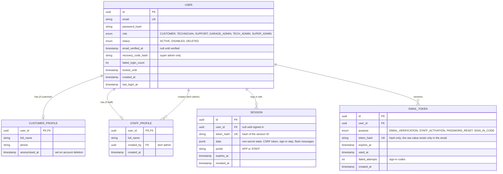
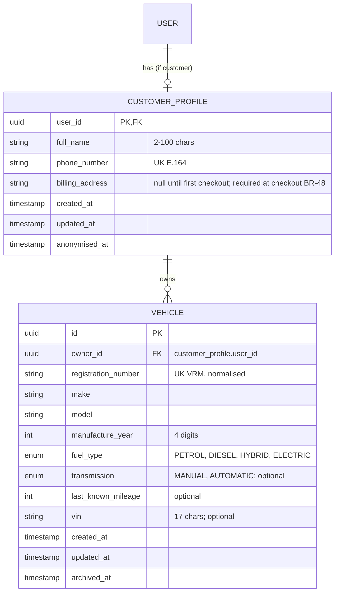
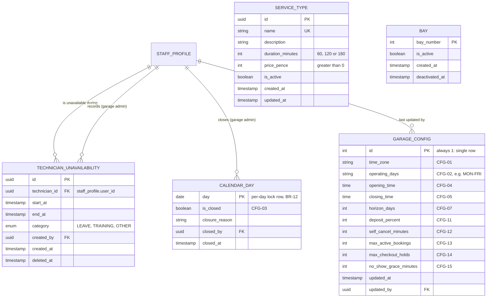
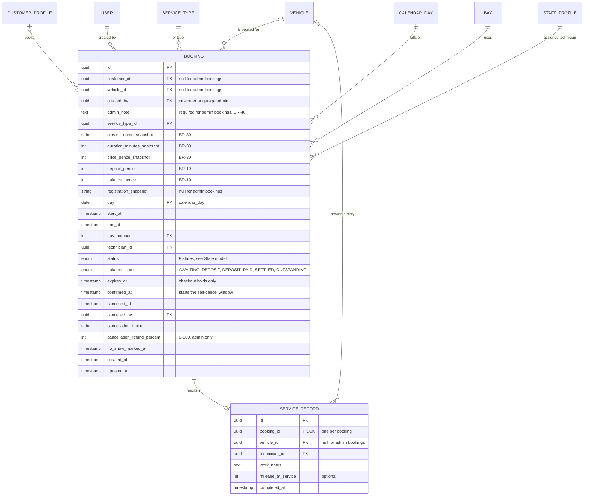
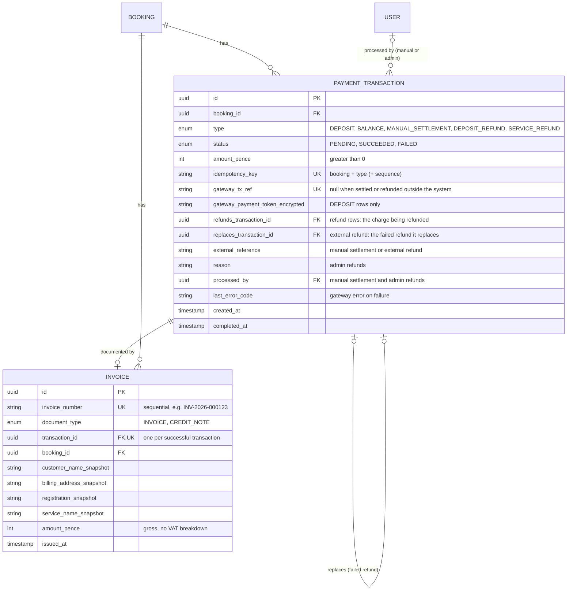
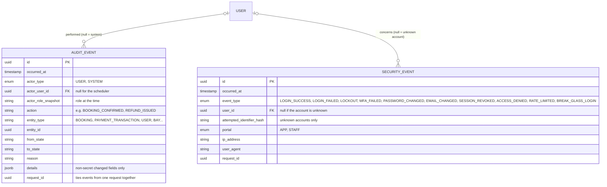
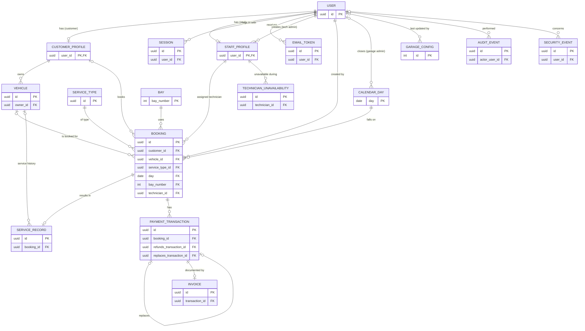

# Entity relationship diagram v0.1

The project's data model, built section by section and agreed with the team before each section is written here. The database is PostgreSQL. Every table uses a UUID primary key, and every rule the database can enforce is noted beside the entity.

## Section 1 · Identity and access

Everyone who logs in is one row in USER; customers and staff differ only by role and by which profile table they have. Authentication, lockout and MFA are therefore written and tested once.

| Decision | Agreed | Why |
| --- | --- | --- |
| One USER table, separate profiles | Yes | One implementation of login, hashing, lockout, rate-limiting and MFA. Each portal's login endpoint accepts only its own roles. |
| Roles | One fixed role per user; capabilities come with the role | No separate permission tables. Least privilege is defined per role and easy to test. |
| Sessions | Stored server-side, ID hashed; a custom session store keeps the session's state in a jsonb column (changed 25 Nov 2026) | Disabling a user or using break-glass revokes every live session at once; a database leak exposes no usable tokens. |
| Break-glass | A USER with role SUPER\_ADMIN plus a recovery code hash | The real code is held offline by the garage and tech admins; the app stores only its hash. |
| Probation | Dropped for this iteration | The team may revisit it later. Status is ACTIVE, DISABLED (staff switched off by the tech admin) or DELETED (customer account anonymised on request). |
| Staff MFA | A one-time sign-in code sent by email (changed 25 Nov 2026) | Team decision AD-11 in the Application user stories tab; replaces the authenticator app. |
| Email links and codes | One EMAIL\_TOKEN table for verification, staff activation, password reset and sign-in codes (added 25 Nov 2026) | One mechanism for every emailed secret: stored only as a hash, single-use, time-limited (AD-13). |

**Database-enforced rules:** email is unique; `recovery_code_hash` is not null only for SUPER\_ADMIN; EMAIL\_TOKEN `token_hash` is unique and `expires_at` is later than `created_at`; at most one unused SIGN\_IN\_CODE per user (partial unique index), so requesting a new code cancels the old one; a profile row's type must match the user's role (enforced in the application, since a check across tables is not portable). Customers cannot sign in until `email_verified_at` is set (application check).

**Change log, 25 Nov 2026:** after the team chose email-based MFA and email verification, `mfa_secret_encrypted` was removed from USER, `email_verified_at` was added, and the EMAIL\_TOKEN table was added. The check constraint requiring an MFA secret for staff was replaced by the EMAIL\_TOKEN rules above. Nothing else in the ERD changed.

**Change log, 25 Nov 2026 (sessions):** the team approved storing session state in SESSION. `user_id` may now be null, because visitors need a session (and a CSRF token) before they sign in, and a `data` jsonb column holds non-secret state: the CSRF token, whether a staff member has still to enter their emailed code, and flash messages. Secrets never go in `data`: passwords and emailed codes live only as hashes elsewhere. The session ID itself is stored only as a hash in `token_hash`.

## Section 2 · Customers and vehicles

Only customer profiles can own vehicles, and a removed vehicle is archived rather than deleted, so past bookings and service history always have a vehicle to point to. Field choices follow the team's Customer and Vehicle Data Research document.

| Decision | Agreed | Why |
| --- | --- | --- |
| Vehicle owner | CUSTOMER\_PROFILE, not USER | The database itself guarantees staff accounts can never own a vehicle. |
| Registration uniqueness | Per customer, among non-archived vehicles | Two accounts may hold the same plate (D-07); one customer cannot add the same car twice. Plates are normalised (uppercase, no spaces) before saving. |
| Removing a vehicle | Archive, never delete | Bookings and service history keep their link (BR-29). Re-adding the car later creates a new row. |
| Mileage | Recorded per visit on the service record (Section 4) | Each visit keeps its own reading; the vehicle shows the last known value. |
| Billing address | Required at every checkout | One rule, no price threshold (BR-48). Copied onto each invoice (Section 5). |
| Changing email | Requires the current password | Email is the login identity, so changing it is a security event. |
| Admin bookings | No vehicle row; details go in the admin's note | Free-text note per BR-46; collecting complete details, including fuel type, is the garage admin's responsibility (BP-01). |

**On account deletion:** profile fields are overwritten and the user's status becomes DELETED. Vehicles are archived, and their VIN and registration are cleared. The registration survives only in the snapshot held by retained bookings and invoices.

**Database-enforced rules:** unique (owner\_id, registration\_number) where archived\_at is null; vin is null or exactly 17 characters; manufacture\_year between 1900 and next year; full\_name 2–100 characters. Blocking removal of a vehicle with an active booking (BR-43) is an application check.

## Section 3 · Garage setup

The garage's business settings, services, bays, closed days and technician absences live here; one row per calendar date doubles as the lock that keeps bookings and closures from colliding. Engineering timings (CFG-09, CFG-10, CFG-16) stay in application config, not in the database.

| Decision | Agreed | Why |
| --- | --- | --- |
| Bays | A BAY table; CFG-08 = number of active bays | A specific bay can be retired (e.g. bay 2's lift breaks). Allocation picks the lowest active free bay (BR-10). |
| Closed days | A flag on CALENDAR\_DAY, the same row bookings lock | Closing a day and booking that day queue on one lock, so BR-31's check cannot race. Rows are created on first use. |
| Engineering timings | Application config, not editable in the app | An admin cannot set a hold or reconciliation time that breaks checkout. |
| Unavailability reason | Category only, no free text | Avoids storing employee health details; sickness counts as LEAVE. |
| Money | Whole pence (integers) | No floating-point rounding errors; BR-19 rounding stays exact. |
| Service types | Seeded with the three services; the garage admin can add or switch them off | Switching off hides a service from new bookings; existing bookings keep their snapshot (BR-30). |
| Capacity changes | Removing a bay, closing a day or shortening opening hours is refused while active bookings depend on it | BR-31 and BP-05. |

**Lock order:** every transaction that allocates takes the calendar\_day row first, then the chosen bay's row. Retiring a bay locks that bay's row before checking its future bookings, so a booking cannot slip into a bay as it is retired. When a transaction needs several rows (a reschedule locks the old and new date), calendar\_day rows are locked in ascending date order and bay rows in ascending bay number. One fixed order means two transactions can never deadlock waiting for each other.

**Database-enforced rules:** GARAGE\_CONFIG has exactly one row (id = 1); closing\_time later than opening\_time; duration\_minutes in (60, 120, 180); price\_pence greater than 0; bay\_number greater than 0; unavailability end\_at later than start\_at; service name unique.

## Section 4 · Bookings

A booking is either a customer booking or an admin booking, never a mix, and the database itself refuses a booking for someone else's vehicle, money that does not add up, or two confirmed bookings in the same bay or with the same technician at once. The work done is recorded separately as a service record.

| Decision | Agreed | Why |
| --- | --- | --- |
| Two booking shapes | Customer booking (customer, vehicle, registration snapshot, no note) or admin booking (no customer or vehicle, note required) | A half-filled booking cannot be saved, even by buggy code. |
| Vehicle ownership | Composite foreign key (vehicle\_id, customer\_id) → vehicle (id, owner\_id) | The database refuses a booking for someone else's car, backing up SEC1 and MS-BK-01. |
| Money and time | deposit + balance = price; end = start + duration | BR-19 and the slot arithmetic can never drift apart. |
| Double-booking safety net | Exclusion constraints on bay and technician for CONFIRMED and REASSIGNMENT\_REQUIRED bookings | Defence in depth behind the lock (BR-12). Checkout holds are not covered because their expiry depends on the current time, so the lock stays essential. |
| Work done | Separate SERVICE\_RECORD, one per booking | Vehicle history is a simple query; technicians can write service records without being able to change bookings; per-visit mileage lives here. |
| Cancellation | Columns on the booking | Cancelling happens at most once; the full change history is in the audit log (Section 7). |
| Payment tokens | Not on the booking | They belong with the money records (Section 5). |
| Admin note visibility | Garage admin and the assigned technician only | The technician needs the fuel type (BP-01); support staff do not. |

**Database-enforced rules:**

- Shape check: (customer\_id, vehicle\_id and registration\_snapshot not null, admin\_note null) or (customer\_id, vehicle\_id and registration\_snapshot null, admin\_note not null).
- Composite foreign key (vehicle\_id, customer\_id) referencing vehicle (id, owner\_id); vehicle needs a matching unique (id, owner\_id).
- deposit\_pence + balance\_pence = price\_pence\_snapshot; end\_at = start\_at + duration\_minutes\_snapshot minutes.
- expires\_at is not null only while status = PENDING\_PAYMENT; cancellation\_refund\_percent between 0 and 100.
- Exclusion constraints (PostgreSQL `btree_gist`): no two bookings with status CONFIRMED or REASSIGNMENT\_REQUIRED share a bay\_number with overlapping \[start\_at, end\_at); the same for technician\_id.
- SERVICE\_RECORD.booking\_id is unique.

Checked in the application: the technician's role is TECHNICIAN; the booking's day matches start\_at in the garage time zone; status transitions follow the State model.

## Section 5 · Money

Every money movement is one row in PAYMENT\_TRANSACTION, and every successful one gets exactly one invoice or credit note. Nothing is retried: each charge or refund is attempted once, and the unique idempotency key only stops accidental duplicates and lets an unknown outcome be looked up.

| Decision | Agreed | Why |
| --- | --- | --- |
| One transaction table | All five money movements share one lifecycle (PENDING → SUCCEEDED or FAILED) | One implementation; checks enforce the differences between types. |
| No retries | Each charge or refund is attempted once | Simpler logic. A failed deposit expires the booking (the customer may book again); a failed balance becomes OUTSTANDING (F/C-4.1); a failed refund is completed outside the system and recorded as a new refund row with an external reference (F/C-8). |
| Idempotency key | Unique column | Stops accidental duplicates (double-click, network resend) at the data layer, and lets F/C-8 look up an unknown outcome without a new attempt. |
| Refund link | Every refund points to the charge it refunds; a refund larger than one charge is split into one row per charge, balance first, then deposit (G-1) | Money only goes back to the original card (MS-BK-08); BR-27 gets an exact running total. |
| Gateway token | On the DEPOSIT row, encrypted; purged on account deletion | It can charge the card, so it is protected like a secret. For admin bookings it is the garage's backup payment method. |
| Invoices | One per successful transaction, with name, billing address, registration and service copied in | Later edits never rewrite an issued invoice. Snapshots are kept for 6 years, including after account deletion, per the team's data research. |
| Invoice numbers | Sequential and human-readable | Invoices need a running number. Safe because records are always looked up by UUID. |
| Admin booking invoices | Customer reference taken from the admin's note; address shown as "paid at counter, see note" | The customer pays at the counter outside the system (BP-02). |
| VAT | Gross amounts, no VAT breakdown, for now | Out of scope for this iteration. |

### What the mock gateway must support

The gateway is a separate Node simulation, but it behaves like a real one so the money mechanics stay realistic.

| # | Behaviour | Needed by |
| --- | --- | --- |
| 1 | Takes card details and returns a token; our app never sees the card number | BR-22 |
| 2 | The same idempotency key always returns the same result, never a second charge | BR-17 |
| 3 | Looks up a request's outcome by idempotency key | F/C-8 |
| 4 | Charges a stored token later, without the card | BR-38 |
| 5 | Refunds only against an original transaction | MS-BK-08, BR-27 |
| 6 | Simulates failures and timeouts on demand | Testing F/C-1, F/C-4, F/C-8 |
| 7 | Authenticates server-to-server calls with a secret and signs any callbacks | Stops anyone faking a "payment succeeded" message |

**Database-enforced rules:** idempotency\_key unique; gateway\_tx\_ref unique when present; amount\_pence greater than 0; MANUAL\_SETTLEMENT and external refunds have external\_reference and processed\_by and no gateway\_tx\_ref; refund rows have refunds\_transaction\_id, other rows do not; replaces\_transaction\_id appears only on refunds completed outside the system and is unique, so a failed refund is replaced at most once (G-3); gateway\_payment\_token\_encrypted only on DEPOSIT rows; INVOICE.transaction\_id unique; invoice\_number unique.

Checked in the application, under a lock on the booking row: total successful refunds never exceed the amount collected (BR-27).

## Section 6 · Customer support (deferred)

Customer support is not part of this iteration, and nothing in the other sections depends on it. Its agreed design is kept in the Support (deferred) tab. The SUPPORT value stays in the USER role list as a reserved role, but no support accounts are created in this iteration.

## Section 7 · Audit and security logging

Business actions and security events are logged in two separate, append-only tables that the application can add to but never change. Secrets are never written to either.

| AUDIT\_EVENT: business actions (BR-44) | SECURITY\_EVENT: authentication and access |
| --- | --- |
| Every booking status change, with actor, reason and from/to state | Logins (success and failure), lockouts, MFA failures |
| Allocations and reassignments, including automatic ones | Password and email changes |
| Every payment transaction outcome | Sessions revoked, including after a staff member is disabled |
| Admin bookings, cancellations, refunds, manual settlements, no-shows | Access denied (403), e.g. requesting another customer's booking |
| Config, bay, closure, opening-hours and service changes | Rate-limit hits |
| Staff accounts created, disabled or re-roled | Every break-glass login |

| Decision | Agreed | Why |
| --- | --- | --- |
| Two tables | Audit events and security events kept apart | Different readers, volumes and purposes. |
| Append-only | The application's database account has INSERT and SELECT only; a trigger blocks UPDATE and DELETE | Even a compromised application cannot rewrite history. No screen edits logs. |
| Never logged | Passwords (even failed), session tokens, gateway tokens, card data, MFA codes, recovery codes | A failed login on an unknown account stores only a hash of what was typed, in case a password was typed into the email box. |
| Account deletion | Events are kept; the user ID no longer leads to a name | The security and accountability record stays intact. |
| Retention | Security events 12 months; audit events 6 years | Audit events explain the financial records kept for 6 years. |
| Readers | Tech admin: all (TA4). Garage admin: audit history of bookings and money only. Super admin: all, during break-glass use. Customers and technicians: none | Least privilege. |
| Deferred | Hash chain for tamper detection; in-app break-glass alerts | Later iterations. Break-glass logins are still logged as security events. |

**Database-enforced rules:** INSERT and SELECT only for the application role on both tables; a trigger rejects UPDATE and DELETE; occurred\_at defaults to the database clock (BR-45).

**Change log, 28 Nov 2026:** the team approved listing every SECURITY\_EVENT event type in place of "...". There are ten, one for each row of the table above: `LOGIN_SUCCESS`, `LOGIN_FAILED`, `LOCKOUT`, `MFA_FAILED`, `PASSWORD_CHANGED`, `EMAIL_CHANGED`, `SESSION_REVOKED`, `ACCESS_DENIED`, `RATE_LIMITED` and `BREAK_GLASS_LOGIN`. The shared error handler writes `ACCESS_DENIED` for every 403. The team also decided to keep a `details` column (for the 403 reason) out of scope for now, so SECURITY\_EVENT does not record why access was denied. Nothing else in the ERD changed.

## Full diagram and flowchart walkthrough

The model has 17 tables for this iteration (EMAIL\_TOKEN added on 25 Nov 2026; see the Section 1 change log). Walking every active flowchart through it found three small gaps; the team approved the fixes, which are now applied and listed at the end.

### Full diagram

Keys and relationships only; each section above holds the full attributes.

### Flowchart walkthrough

Each step of every active flowchart was checked for the data it reads and writes. F/C-7 is deferred with support and was not walked.

| Flowchart | Tables the steps use | Result |
| --- | --- | --- |
| F/C-1 Booking and deposit | GARAGE\_CONFIG, SERVICE\_TYPE, CALENDAR\_DAY, BAY, TECHNICIAN\_UNAVAILABILITY, USER, VEHICLE, BOOKING, PAYMENT\_TRANSACTION, INVOICE, CUSTOMER\_PROFILE, AUDIT\_EVENT | Every step finds its data. Caps count bookings by customer\_id, or by created\_by for admins. |
| F/C-2.1 Customer cancel | BOOKING, GARAGE\_CONFIG, PAYMENT\_TRANSACTION, INVOICE | Complete. The refund points to the DEPOSIT row. |
| F/C-2.2 Admin cancel | BOOKING, PAYMENT\_TRANSACTION, INVOICE | Complete. Reason and refund % are stored on the booking. |
| F/C-2.3 Goodwill refund | BOOKING, PAYMENT\_TRANSACTION, INVOICE | **Gap G-1.** |
| F/C-3 Unavailability | TECHNICIAN\_UNAVAILABILITY, USER, SESSION, CALENDAR\_DAY, BOOKING | Complete. The admin queue is a query on status. |
| F/C-3.1 Resolve flagged booking | CALENDAR\_DAY, BAY, BOOKING, TECHNICIAN\_UNAVAILABILITY | **Gap G-2.** |
| F/C-4 Completion | BOOKING, SERVICE\_RECORD, VEHICLE, PAYMENT\_TRANSACTION, INVOICE | Complete. The balance charge reads the token from the booking's DEPOSIT row. |
| F/C-4.1 Manual settlement | BOOKING, PAYMENT\_TRANSACTION, INVOICE | Complete. |
| F/C-5 No-show | BOOKING, GARAGE\_CONFIG, AUDIT\_EVENT | Complete. Who marked it comes from the audit event. |
| F/C-6.1 Scheduled sweep | BOOKING, PAYMENT\_TRANSACTION, AUDIT\_EVENT | Complete. The scheduler is logged as actor SYSTEM. |
| F/C-6.2 Late payment | As F/C-1 | Complete. |
| F/C-8 Reconciliation | PAYMENT\_TRANSACTION, BOOKING, INVOICE | **Gap G-3.** |

### Gaps found (fixes approved and applied)

| ID | Gap | Proposed fix |
| --- | --- | --- |
| G-1 | A goodwill refund on a completed job can be larger than either single charge (e.g. a £100 refund when the deposit was £20 and the balance £180), but each refund row points to one charge. | Split the refund into one row per original charge, balance first, then deposit, each within that charge's remaining refundable amount. Gateway refunds are per charge anyway (mock gateway requirement 5). Each row gets its own credit note. |
| G-2 | A reschedule locks two calendar\_day rows (old and new date). Two reschedules locking the same two days in opposite order could deadlock. | Extend BR-12's lock order: calendar\_day rows in ascending date order, then bay rows in ascending bay number. |
| G-3 | After a failed refund is completed outside the system, nothing links the new refund row to the failed one, so the failed row would stay in the admin queue forever. | Add `replaces_transaction_id` to PAYMENT\_TRANSACTION. The admin queue shows FAILED refunds that nothing replaces. |
