# Booking ecosystem flowcharts v0.2

Draft Mermaid sources for every booking flow, rebuilt on the v0.2 specification. Every decision diamond cites the rule (BR) it implements, and every status change cites its transition (TR).

## Conventions

All flowcharts use the same five shapes, so a reviewer can check any diagram against the spec in one pass.

| Shape | Mermaid | Means |
| --- | --- | --- |
| Stadium | `([ ])` | Start or end; error ends state the HTTP code |
| Diamond | `{ }` | Decision, labelled with the BR it implements |
| Rectangle | `[ ]` | Action; status changes are written "TR-xx: status = X" |
| Hexagon | `{{ }}` | Gateway call, always outside any database transaction (BR-18) |
| Subgraph | `subgraph` | One database transaction: all of it commits or none of it does |

Three rules hold everywhere and are not redrawn in each chart:

- **Guarded transitions:** every status change only applies if the booking is still in the expected from-state. If no row changes, the flow ends with 409 Conflict and an audit entry.
- **Audit:** every transition and every transaction writes an audit entry (BR-44).
- **Server time:** every "now" is the database clock in the garage time zone (BR-45, CFG-01).

One new parameter is introduced here: **CFG-16, reconciliation threshold**, proposed at 10 minutes (used in F/C-6 and F/C-8). It needs adding to the Configuration table.

## F/C-1 Booking, hold, allocation and deposit

The booking is created as a hold in transaction 1, the card is charged outside any transaction, and the booking is confirmed in transaction 2 only if the hold and the technician are still valid. Covers US-BK-01 to US-BK-03, and US-BK-19 for a garage admin booking on a customer's behalf.

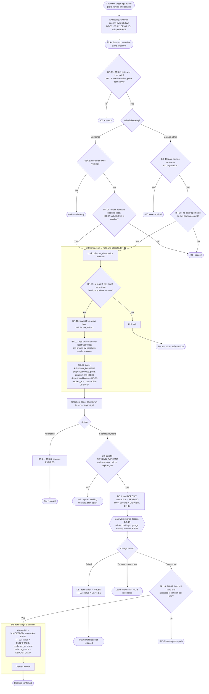

**What changed from your version:** date-row lock (EC-10), hold check before charging (EC-08), gateway outside the transactions (EC-09), vehicle and cap checks (EC-11, MS-BK-02), abandon exit, and the late-success branch.

## F/C-2.1 Customer self-cancellation

The slot is freed the moment the cancellation commits; the refund follows separately and can fail without undoing the cancellation. Covers US-BK-04 and US-BK-05.

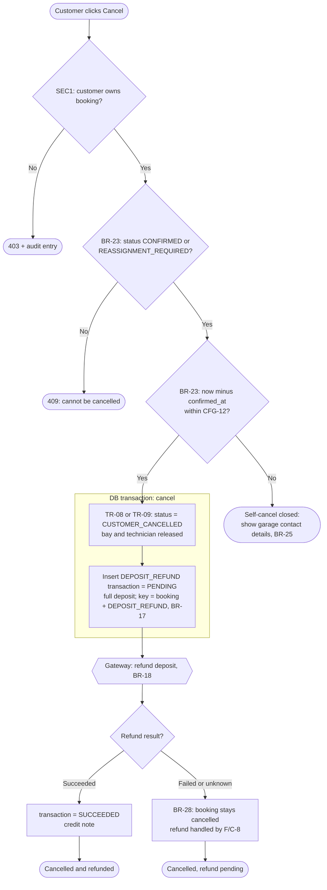

**What changed:** REASSIGNMENT\_REQUIRED path (EC-13), window from confirmed\_at (EC-07), refund outside the transaction with a failure path (EC-09), late-request exit (EC-05).

## F/C-2.2 Garage admin cancellation

The admin chooses the refund percentage and must give a reason; the refund then runs exactly as in F/C-2.1. Covers US-BK-13, including late cancellations customers raise with the garage by phone or email (BP-07).

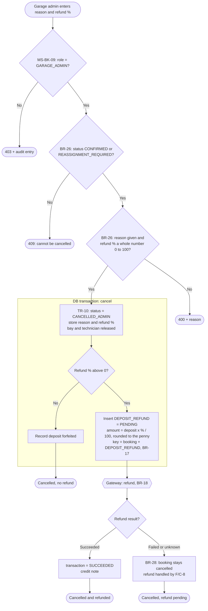

**What changed:** "0 or 1 to 100" simplified to 0 to 100; reason mandatory; refund outside the transaction (EC-09).

## F/C-2.3 Goodwill refund (completed or no-show)

One refund screen serves completed jobs, no-shows and unresolved bookings. A booking can be refunded more than once, but the running total never exceeds what the gateway collected, and the booking's status never changes. Covers US-BK-14.

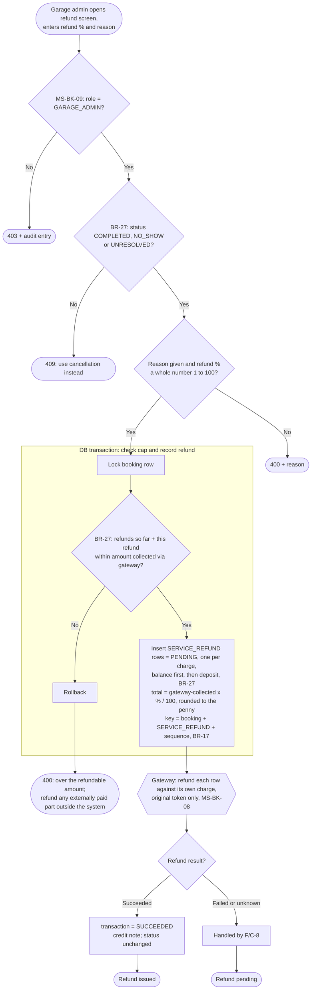

The booking row is locked while the running total is checked, so two admins refunding at once cannot both pass V4. **What changed:** cumulative cap and original-token-only refunds (EC-15, MS-BK-08).

## F/C-3 Technician unavailability and reassignment

When a technician becomes unavailable, the system first moves each affected booking to another free technician; only bookings it cannot move are flagged for the garage admin. Covers US-BK-11, US-BK-12 and US-BK-18.

### F/C-3 Mark unavailable or disable

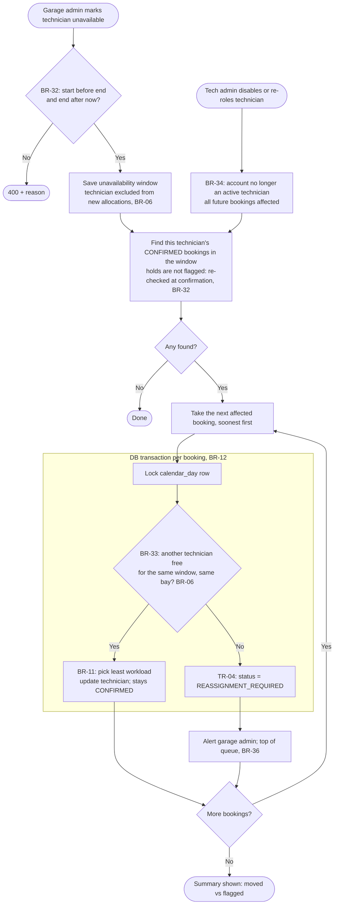

### F/C-3.1 Resolve a flagged booking

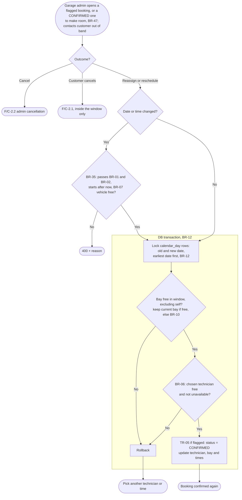

If the unavailability window is later deleted, the original technician passes V4 again (EC-24). **What changed:** window validation, CONFIRMED-only flagging (EC-06), automatic move first (D-02), technician-disable entry point (EC-14), full re-validation on reschedule (EC-19).

## F/C-4 Completion and balance charge

The work is recorded as done before the balance is charged, so a failed charge only marks the balance OUTSTANDING and never leaves a finished job in limbo. Covers US-BK-10 and US-BK-15.

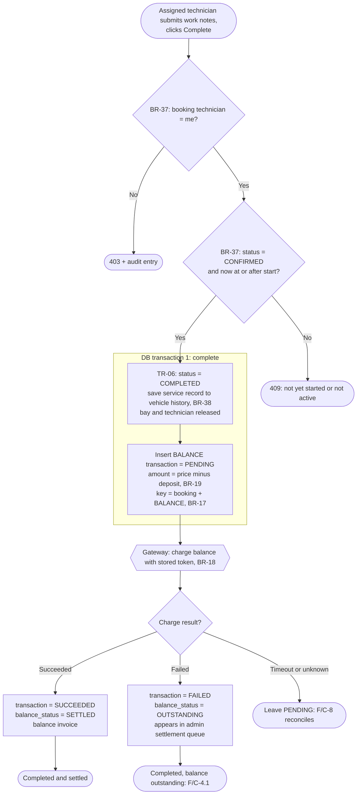

### F/C-4.1 Manual settlement

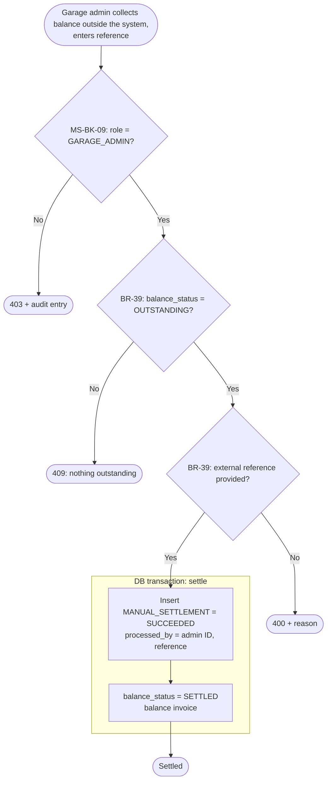

The manual amount is not refundable through the gateway (BR-27). **What changed:** start-time check (EC-21), work saved before charging, COMPLETED\_PAYMENT\_FAILED replaced by balance OUTSTANDING (D-06), idempotent charge (EC-09).

## F/C-5 No-show

A booking the customer never turns up for is closed as NO\_SHOW: the deposit is kept and the balance is never charged. Covers US-BK-16.

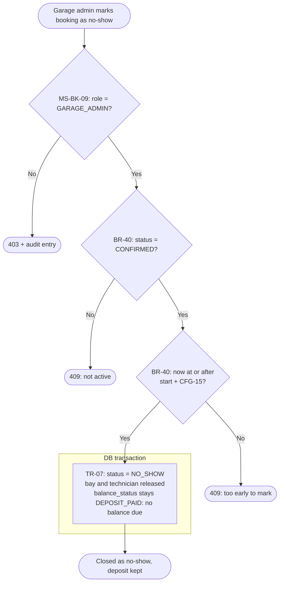

**New flow** (EC-04).

The kept deposit can still be returned later as a goodwill refund through F/C-2.3, for example when the customer had a valid reason.

## F/C-6 Scheduled jobs and late payment

One scheduled job releases lapsed holds and marks flagged bookings UNRESOLVED once their start time has passed; the late-payment path confirms a paid booking if a slot is still free and refunds it in full otherwise.

### F/C-6.1 Scheduled sweep (every minute)

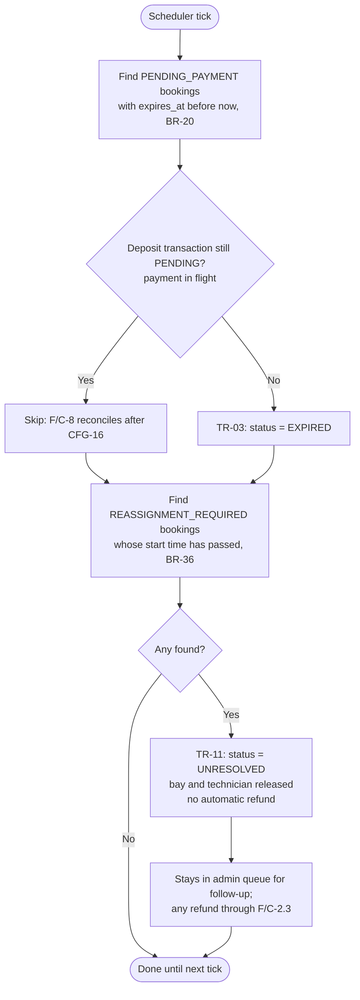

Skipping holds with a payment in flight is what lets the late-payment path below rely on the booking still being PENDING\_PAYMENT.

### F/C-6.2 Late payment (from F/C-1)

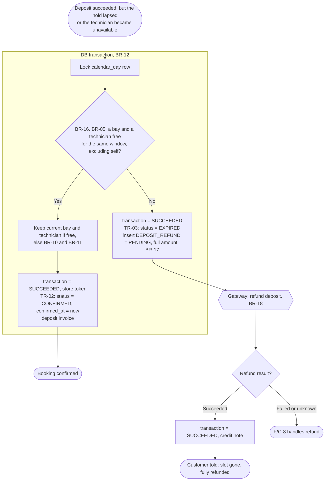

**New flows** (EC-08, EC-20).

## F/C-7 Late cancellation request (deferred with support)

Not built in this iteration: late cancellations go through the garage by phone or email (BP-07). Kept for when support returns. After the self-cancel window, the customer raises a request through support; the booking does not change until a garage admin decides. Covers US-BK-06.

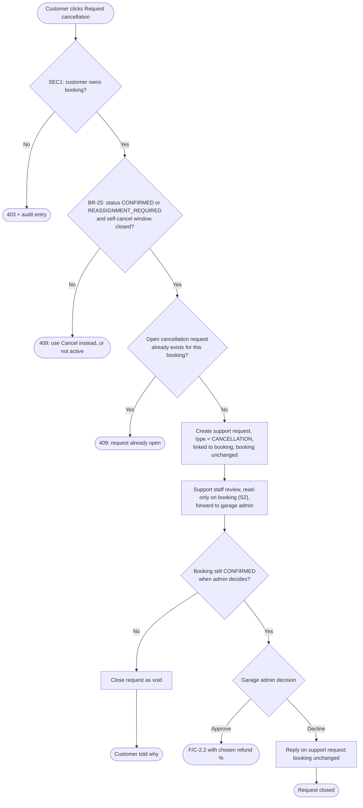

**New flow** (EC-05).

## F/C-8 Payment failure and reconciliation

Every transaction that failed or has stayed PENDING longer than CFG-16 ends up here; nothing is ever retried. An unknown outcome is looked up with the gateway, and a failed refund is completed outside the system and recorded.

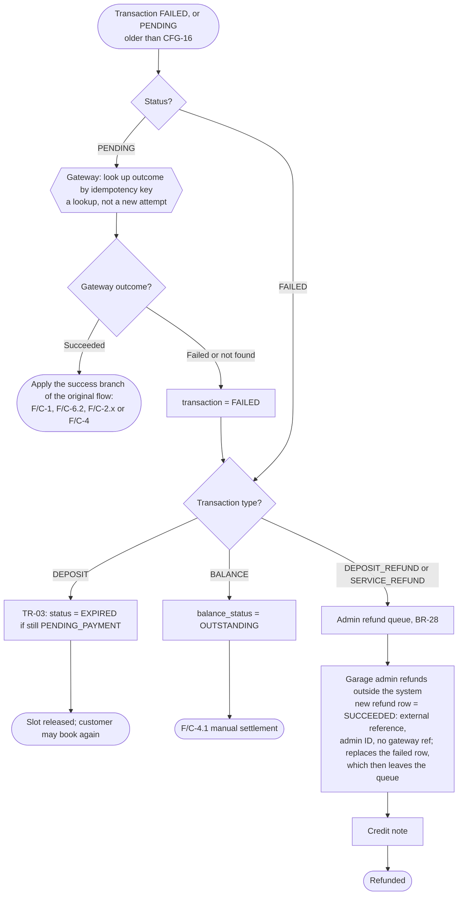

**New flow** (EC-09). No transaction is ever retried. Retries and chargebacks stay out of scope for now.
